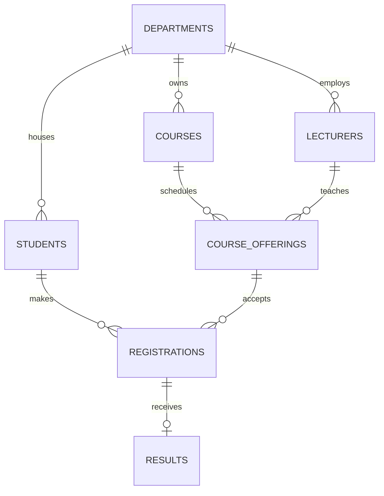

# Portfolio 1 · Design and modelling (7 marks)

UniResult is a simulated university records system. Students read transcripts, lecturers submit marks for assigned offerings, departmental administrators manage registrations, and examination officers oversee corrections. Role enforcement and approval audit trails are outside this lab. Course credits and the grading policy are assumed stable over the simulated period. A production transcript would version both policies.

Run schema.sql, seed.sql and check.sql in that order on a fresh lab database. Seed data includes a pending result, a failed attempt and a successful retake in another session. All identities are synthetic.

## Relational schema and dependencies

| Relation | Primary key | Alternate keys | Other attributes and references |
|---|---|---|---|
| departments | department_id | name | |
| students | student_id | matric_number, email (each unique) | full_name, department_id → departments |
| lecturers | lecturer_id | staff_number | full_name, department_id → departments |
| courses | course_id | course_code | title, credits, department_id → departments |
| course_offerings | offering_id | (course_id, session_start, semester) | lecturer_id → lecturers, course_id → courses |
| registrations | registration_id | (student_id, offering_id) | registered_on, student_id → students, offering_id → course_offerings |
| results | registration_id | | registration_id → registrations, score |

A combined academic record would repeat department names, course credits and lecturer names whenever another student registered. In 1NF, each row records one fact at its stated grain with scalar values, removing repeating course and result groups. For 2NF, student attributes depend on the student key, offering details on the offering key, and registration date on the whole student–offering pair. For 3NF, department names live in departments, which removes the transitive dependency from student, lecturer and course keys through department_id. Course credits live with the course and lecturer names with the lecturer. Within each final relation the stated business dependencies have candidate keys as determinants. A result row exists only after a score is recorded. The view derives grade and points from score, and GPA weights posted points by course credits. Retakes count as separate attempts.

Check.sql asserts the 12 registrations, 11 posted results and a semester GPA of 4.60 for Amara, then tries duplicate registration, orphan result and out-of-range score inside a rolled-back transaction. Capture the actual output and table constraints for evidence.
